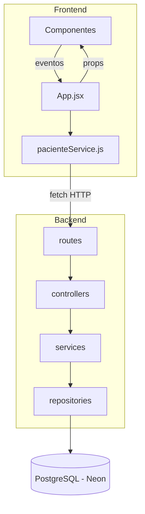

# VetPenguin: Sistema de Información vetChiloé

Una aplicación web moderna y responsiva diseñada para gestionar y realizar el seguimiento de los datos de pacientes en clínicas veterinarias. Este proyecto sirve como base educativa para construir interfaces web escalables utilizando el ecosistema moderno de JavaScript, utilizando React.

Este proyecto se enmarca dentro de la asignatura de Tecnologías Web y Móviles de 6to Semestre en la carrera de Ingeniería Civil en Informática, de la Universidad de Los Lagos.

**Rama de trabajo:** `estudiante/valentina-calderon`

## 🎯 Propósito del Sistema

El propósito principal de este repositorio es pedagógico. Busca enseñar a los estudiantes de ingeniería la arquitectura web basada en componentes, el manejo unidireccional del estado, y la implementación de interfaces de usuario (UI) y experiencias de usuario (UX) de alto nivel, transitando progresivamente hacia un sistema Full-Stack.

## 🚀 Stack Tecnológico

**Frontend:**

* Librería Core: React + Vite
* Estilos: CSS3 nativo, con un archivo base (`index.css`) para colores, letra y tamaños
* Animaciones: react-card-flip (carnet giratorio)

**Backend:**

* Entorno de ejecución: Node.js
* Framework: Express.js (API REST)
* Base de datos: PostgreSQL en la nube (Neon), conectada con `pg` y `dotenv`

**Despliegue:**

* Frontend: Vercel
* Backend: Render (Web Service)
* Base de datos: Neon

## ✨ Funcionalidades Principales (UI/UX)

* **Pestañas de navegación:** Inicio, Pacientes y Dados de alta, sin recargar la página.
* **Tabla de pacientes:** tabla responsiva con foto, N° de atención, especie con color, edad y diagnóstico.
* **Registro de pacientes:** formulario en ventana (modal) que se abre con un botón flotante. Incluye datos de la mascota, foto y datos del dueño.
* **Reingreso:** si la mascota ya tiene ficha, se busca por su N° de atención y solo se registra el motivo de la nueva visita.
* **Carnet clínico:** tarjeta giratoria con la foto y datos en el anverso, y la ficha con el dueño en el reverso. Desde ahí se puede dar de alta al paciente.
* **Detalle del paciente:** estado (en tratamiento o dado de alta), antecedentes, dueño e historial completo.
* **Eliminar paciente:** con ventana de confirmación.

## 🧱 Arquitectura en N-Capas

El sistema está separado en capas. Cada capa tiene una sola responsabilidad y solo conversa con la capa vecina.



| Capa | Ubicación | Responsabilidad |
|---|---|---|
| Vista | `src/components/` | Solo muestran información, todo les llega por props |
| Servicios (frontend) | `src/services/pacienteService.js` | Pide y envía los datos a la API con `fetch` |
| Rutas | `server/src/routes/` | Define las URL (GET, POST) y a qué controlador van |
| Controladores | `server/src/controllers/` | Traducen HTTP: leen `req` y responden con `res` |
| Servicios (backend) | `server/src/services/` | Reglas de negocio: valida la especie y genera el N° de atención |
| Repositorios | `server/src/repositories/` | Los únicos que tocan la base de datos, con consultas SQL |

## 🔌 Endpoints

| Método | Ruta | Respuesta |
|---|---|---|
| GET | `/api/pacientes` | `200` con la lista de pacientes |
| POST | `/api/pacientes` | `201` con el paciente creado |
| POST | `/api/pacientes` con especie no permitida | `400` con el mensaje de error |

## 📁 Estructura del Proyecto

```
vetChiloe/
├── public/
│   └── pacientes/                  # Fotos de los pacientes
├── server/                         # Backend (Node.js + Express)
│   ├── database/
│   │   └── pacientes.sql           # Tabla y paciente de prueba
│   ├── src/
│   │   ├── controllers/
│   │   │   └── pacientes.controller.js
│   │   ├── repositories/
│   │   │   └── pacientes.repository.js
│   │   ├── routes/
│   │   │   └── pacientes.routes.js
│   │   ├── services/
│   │   │   └── pacientes.service.js
│   │   └── app.js                  # Enciende el servidor
│   ├── .env.example                # Variables que hay que crear en .env
│   └── package.json
├── src/                            # Frontend (React)
│   ├── components/
│   │   ├── BarraPestanas.jsx       # Pestañas de navegación
│   │   ├── DetallePaciente.jsx     # Ventana con el detalle completo
│   │   ├── FichaClinica.jsx        # Carnet giratorio
│   │   ├── FormularioPaciente.jsx  # Registro y reingreso
│   │   ├── TablaPacientes.jsx      # Tabla del listado
│   │   └── TarjetaPaciente.jsx     # Anverso del carnet
│   ├── data/
│   │   └── Razas.jsx               # Especies y razas del formulario
│   ├── services/
│   │   └── pacienteService.js      # Conexión con la API
│   ├── App.jsx                     # Componente raíz y estado global
│   ├── index.css                   # Colores, letra y tamaños base
│   └── main.jsx
├── package.json
└── README.md
```

## ⚙️ Requisitos Previos

* [Node.js](https://nodejs.org/) (incluye npm) instalado en tu computadora local.
* Git instalado en tu entorno de desarrollo.

## 🛠️ Instalación y ejecución

1. Clona el repositorio y entra a la rama:
   ```bash
   git clone https://github.com/Vikktor93/vetChiloe
   cd vetChiloe
   git checkout estudiante/valentina-calderon
   ```

2. Base de datos: en el SQL Editor de Neon se ejecuta `server/database/pacientes.sql`.

3. Backend (terminal 1). Primero se crea `server/.env` copiando `server/.env.example` y poniendo la cadena de conexión de Neon:
   ```bash
   cd server
   npm install
   npm run dev
   ```
   Queda funcionando en `http://localhost:3000`.

4. Frontend (terminal 2, desde la carpeta raíz):
   ```bash
   npm install
   npm run dev
   ```
   Queda funcionando en `http://localhost:5173`.

> El archivo `.npmrc` activa `legacy-peer-deps` porque `react-card-flip` todavía pide React 18. Así también funciona la instalación en Vercel.
## 🌐 Sitio publicado

* Frontend (Vercel): pendiente
* Backend (Render): pendiente
